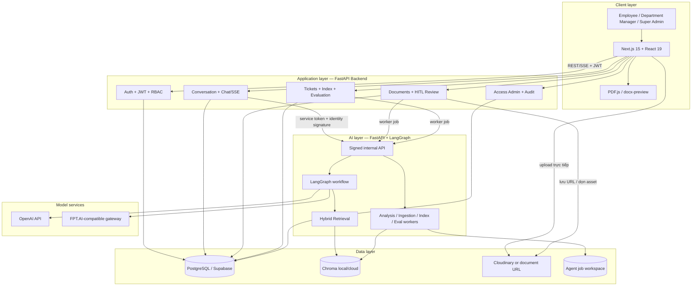
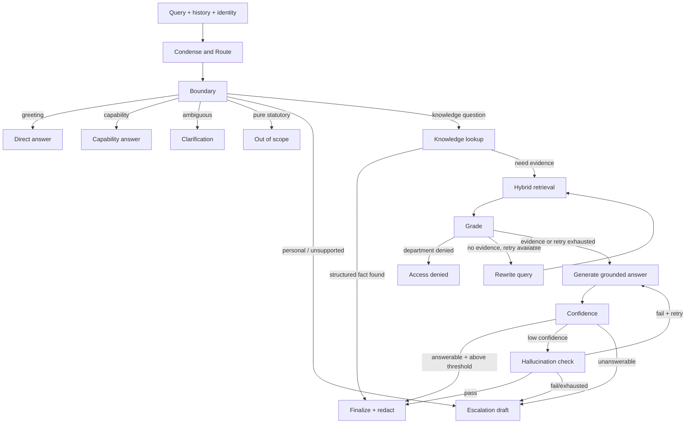
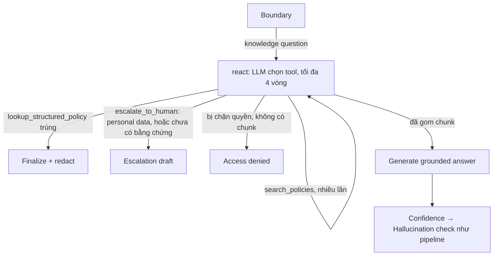
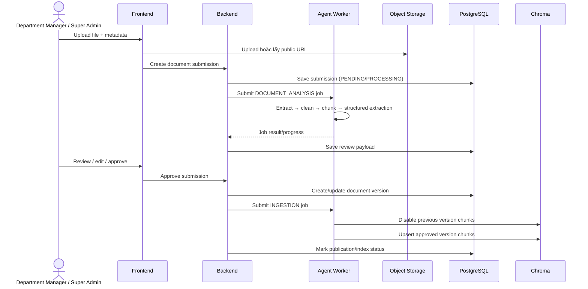
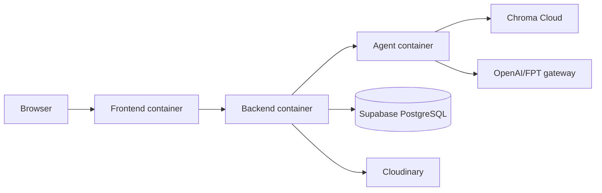

# Kiến trúc hệ thống P-153

**Phiên bản tài liệu:** 2026-09-01
**Đối chiếu source:** `develop@87a85aa`

## 1. Mục tiêu kiến trúc

P-153 là hệ thống Enterprise Document Intelligence tách thành ba service. Kiến trúc ưu tiên bốn thuộc tính: câu trả lời có bằng chứng, phân quyền fail-closed, quy trình xuất bản có người duyệt và khả năng thay thế model/vector backend bằng cấu hình.

## 2. Sơ đồ tổng thể

## 3. Trách nhiệm từng service

### 3.1 Frontend

Source chính: `frontend/app`, `frontend/components`, `frontend/lib`.

- Quản lý phiên đăng nhập và điều hướng theo vai trò.
- Chat nhiều lượt, SSE streaming và fallback polling.
- Hiển thị citation card; mở DOCX/PDF và highlight đoạn liên quan.
- Quản lý ticket của nhân viên hoặc hàng đợi theo phòng ban.
- Upload, theo dõi phân tích, duyệt/từ chối, archive và quản lý phiên bản tài liệu.
- Giao diện quản trị quyền, index và evaluation.
- `monitoring` hiện chỉ là placeholder, không được tính là chức năng hoàn thành.

### 3.2 Backend API

Source chính: `backend/app/api/v1`, `backend/app/services`, `backend/app/domain/models`.

- Là public boundary duy nhất cho Frontend.
- Xác thực JWT, nạp lại profile/role từ database và áp dụng RBAC.
- Sở hữu conversation, message, chat request, ticket, document, submission, audit và job metadata.
- Ký identity khi gọi Agent; Agent không tin trực tiếp các field role/department từ client.
- Quản lý lifecycle bất đồng bộ và phục hồi chat request chưa kết thúc sau restart.
- Điều phối document-analysis, ingestion, index-rebuild và evaluation jobs.

### 3.3 Agent service

Source chính: `src/agents`, `src/retrieval`, `src/ingestion`, `src/workers`.

- Cung cấp API nội bộ `/api/v1/agent/query`, `/query/stream` và worker job endpoints.
- Kiểm tra service token và identity signature.
- Chạy LangGraph, truy xuất tài liệu, tạo câu trả lời và citation. Hai chế độ: `pipeline` (graph cố định) hoặc `react` (LLM tự gọi tool), chọn bằng `AGENT_MODE`.
- Không tự ghi ticket nghiệp vụ; Agent trả `ticket_draft`, Backend quyết định persistence.
- Quản lý execution state của worker jobs và đánh dấu job stale thành failed khi restart.

## 4. Luồng LangGraph

### Chế độ agent (`AGENT_MODE=react`)

Mặc định là `pipeline` (sơ đồ trên). Khi đặt `AGENT_MODE=react`, nhánh "knowledge question" đi vào node `react` thay cho Knowledge lookup → Retrieval → Grade → Rewrite. Từ Generate trở đi giữ nguyên.

- Tool `search_policies` gọi lại đúng `retrieval_node` và `grade_node`, nên ACL, lifecycle, hybrid và rerank giữ nguyên. Danh tính lấy từ state, không lấy từ tham số tool.
- Model chỉ gom bằng chứng, không viết câu trả lời cuối. `escalate_to_human(missing_evidence)` khi đã có chunk thì chỉ dừng vòng gọi tool, để Generate + Confidence quyết định, vì model chỉ thấy bản tóm tắt chunk.
- Mỗi tool call phát event SSE `status` (custom stream của LangGraph), nên UI thấy agent đang tìm gì.
- Model lỗi hoặc không gọi tool: tìm 1 lần bằng câu gốc, giống pipeline.
- Số đo 09/11 (`qa_eval_set`, 67 câu in_scope): pipeline 33/67, react 43/67, thắng 10 câu, thua 0; p50 2,0 s → 4,9 s. ACL end-to-end 15/15 ở cả hai chế độ (`eval/scripts/eval_acl_e2e.py`).

- Tool `calculate_annual_leave`: LLM chỉ trích tham số, code tính theo mục 4.1–4.2 của chính sách nghỉ phép; chỉ trả số khi search lấy được chính sách đó, và phép tính thành chunk dẫn nguồn để numeric grounding kiểm được.
- Trajectory eval (`eval/scripts/eval_agent_trajectory.py`): chọn tool đúng 10/10 trên bộ có nhãn; trên 67 câu in_scope trung bình 3,3 lời gọi LLM, ~9.900 token, 1,9 lần search; 6 câu chỉ tìm được gold nhờ tìm lại; ~16% lần search không đem về chunk mới.

### Hành động có người duyệt (`CREATE_CASE`)

Agent không ghi nghiệp vụ; nó trả `ticket_draft`. Backend lưu `chat_requests.ticket_proposal` (migration 0014) chỉ khi: cờ `ENABLE_CREATE_CASE` bật, registry đặt `max_runtime_action = CREATE_CASE` cho scenario (6/64), scenario không `HUMAN_FIRST`/`Critical`. Ticket chỉ được tạo qua `POST /api/v1/chat/requests/{id}/ticket` do chính người hỏi gọi; endpoint khoá hàng và trả lại ticket cũ nếu đã tạo (idempotent). Cờ tắt = hành vi MVP-1 (0 ticket từ luồng chat).

MCP server `src/mcp_server.py` (stdio) bọc `answer()` thành tool `ask_documents`; danh tính lấy từ env `MCP_*`.

### Retrieval pipeline

1. Condense lịch sử và giải coreference.
2. Mở rộng mốc thời gian trong câu hỏi thành các biến thể chuẩn hóa.
3. Xác định domain/collection và dựng ACL predicate từ tenant, role, department, scope và lifecycle.
4. Chạy dense retrieval; khi bật hybrid, kết hợp BM25 bằng reciprocal-rank fusion.
5. Đa dạng hóa theo nguồn cho câu hỏi multi-source và rerank ứng viên.
6. Chỉ chuyển chunks đã qua authorization sang generation.
7. Kiểm tra numeric grounding, citation markers, confidence và PII trước khi trả.

## 5. Luồng tài liệu và HITL

Các định dạng được extractor hỗ trợ trong source: PDF, DOCX, XLSX, Markdown và ảnh. Tài liệu scan/ảnh có thể dùng VLM; bảng PDF được giữ cấu trúc khi có thể.

## 6. Dữ liệu và quyền truy cập

### PostgreSQL/Supabase

Chuỗi migration `0001`–`0012` tạo và gia cố các bảng cho user/profile, conversation/message, chat request, documents, ingestion/index/evaluation jobs, tickets, audit và document review.

### Chroma

- Collection được phân giải theo tenant/domain.
- Metadata chứa department, access scope, authority, provenance, lifecycle, version, effective date và vị trí nguồn.
- Phiên bản cũ bị soft-disable khỏi retrieval thay vì xóa lịch sử ngay lập tức.

### Mô hình quyền

| Vai trò | Phạm vi chính |
|---|---|
| `EMPLOYEE` | Chat, ticket cá nhân, tài liệu `COMPANY_WIDE` và tài liệu phòng ban được cấp |
| `DEPARTMENT_MANAGER` | Quyền Employee + quản lý ticket/tài liệu đúng phòng ban |
| `SUPER_ADMIN` | Quản trị toàn hệ thống, access model, audit, evaluation |

Quyền được kiểm tra ở Backend và lặp lại tại retrieval. Role hoặc department không hợp lệ phải dẫn tới deny, không fallback sang quyền rộng hơn.

## 7. Giao tiếp và contract

- Frontend ↔ Backend: JSON REST, SSE cho chat streaming, JWT bearer token.
- Backend ↔ Agent: service token; identity trace được ký để chống sửa role/department.
- Backend ↔ PostgreSQL: SQLAlchemy async.
- Agent ↔ Chroma/model provider: network API hoặc local vector client tùy cấu hình.
- Worker job: submit `202 Accepted`, Backend poll trạng thái và mirror kết quả vào database.

## 8. Triển khai

- Local: `docker-compose.yml` build ba container, Agent chỉ expose trong network Compose.
- Cloud blueprint: `render.yaml` khai báo ba web service và secret qua environment variables.
- Health endpoints tồn tại ở Backend và Agent; warmup được thực hiện tại startup, không ping Agent trên mỗi health request.

## 9. Quyết định kiến trúc và giới hạn

| Quyết định | Lý do |
|---|---|
| Tách Backend và Agent | Cô lập auth/database nghiệp vụ khỏi workload AI và worker |
| HITL trước khi xuất bản | Không để extraction tự động trở thành tri thức chính thức nếu chưa duyệt |
| ACL ở hai lớp | Giảm rủi ro bỏ lọt quyền do chỉ kiểm tra UI/API |
| Hybrid retrieval | Bù điểm yếu của vector search với mã văn bản, ngày tháng và thuật ngữ chính xác |
| Provider abstraction | Có thể chuyển OpenAI/FPT qua cấu hình mà không thay graph |
| Soft archive | Giữ audit/version history nhưng loại phiên bản cũ khỏi retrieval |

Giới hạn hiện tại: monitoring dashboard chưa triển khai; test live cần hạ tầng ngoài; một số tài liệu lịch sử mô tả kiến trúc cũ và không thay thế tài liệu chuẩn này.
