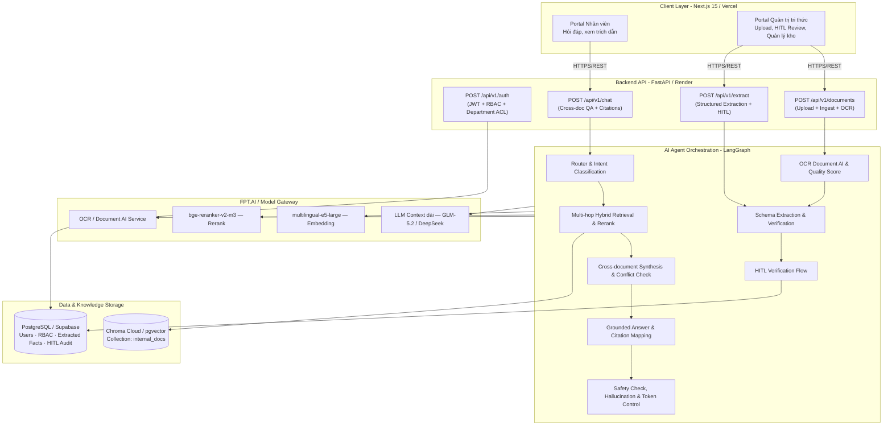
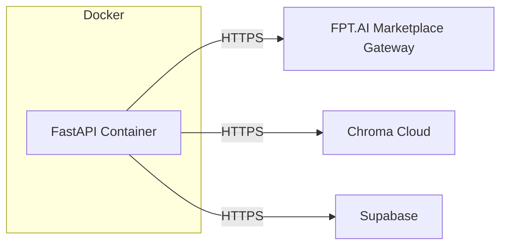

# Architecture Document — AI agent Tóm tắt và trích xuất tri thức tài liệu nội bộ (Doc Intelligence Agent) (P-153)

## System Overview

Hệ thống **Doc Intelligence Agent** giải quyết bài toán khai thác tri thức và tài liệu nội bộ của **VinBigData** (quy trình, biên bản họp, quyết định, quy chế). Hệ thống được xây dựng trên nền tảng **LangGraph**, phục vụ thông qua API **FastAPI**, giao diện web **Next.js 15**, và cơ sở dữ liệu **PostgreSQL (Supabase)**.

Hệ thống cung cấp các năng lực cốt lõi:
1. **Document Ingestion & OCR:** Tiếp nhận tài liệu số (PDF, DOCX) và tài liệu scan thông qua module **OCR (Document AI)** với cơ chế đánh giá chất lượng OCR Confidence Score.
2. **Schema Extraction có kiểm chứng:** Tự động tóm tắt và bóc tách các trường thông tin hành động có cấu trúc (*Quyết định, Trách nhiệm, Deadline*) theo schema Pydantic được xác thực.
3. **Human-in-the-Loop (HITL):** Giao diện và luồng nghiệp vụ cho phép Quản trị tri thức / Chuyên viên review, chỉnh sửa và bấm xác nhận trước khi lưu kho tri thức chính thức.
4. **Hỏi đáp & Tổng hợp xuyên tài liệu (Cross-document QA):** Tìm kiếm lai (Hybrid Search: Dense Vector + BM25) kết hợp Reranker và suy luận đa chặng (multi-hop reasoning), đảm bảo 100% câu trả lời có trích dẫn nguồn có thể kiểm chứng.
5. **Bảo mật & Phân quyền theo phòng ban:** Tích hợp RBAC (Nhân viên, Quản trị tri thức) và bộ lọc truy cập tài liệu theo phòng ban.
6. **Kiểm soát chi phí & Quản lý Token:** Cảnh báo giới hạn token và áp dụng chiến lược tóm tắt phân tầng cho tài liệu dài.

---

## Architecture Diagram

## Components

### 1. Frontend
- **Trạng thái:** chưa dựng trên nhánh `feature/rag-agent-pipeline`. Có bản demo UI thử nghiệm trên nhánh khác (commit `1e8b3af`, 2026-08-05) — chưa hợp nhất.
- **Kế hoạch:** Next.js hoặc Streamlit, gọi `POST /api/v1/chat`, hiển thị `citations` kèm cảnh báo khi `is_official_policy=False`.

### 2. Backend (FastAPI)
- **Entry point:** `src/main.py` → include router `src/api/routes.py` với prefix `/api/v1`.
- **Endpoint chính:** `POST /api/v1/chat` — lớp mỏng gọi `src/agents/service.py::answer(query, history=None)`, trả `ChatResponse` (kế thừa `AgentAnswer`). `history` optional cho multi-turn — backend tự lưu/truyền lại, agent không tự lưu session. Contract đầy đủ: [`docs/rag-pipeline/AGENT_API.md`](docs/rag-pipeline/AGENT_API.md).
- **Backend thống nhất:** `backend/` cung cấp Conversation/Chat RAG/Citation API và dùng PostgreSQL của dự án Supabase qua `DATABASE_URL`.
- **Authentication:** Backend xác thực bảng `public.users` (`hashed_password`), phát JWT và lấy RBAC từ `public.profiles`; không dùng Supabase Auth cho luồng đăng nhập hiện tại.

### 3. AI Agent (LangGraph)
- **Agent type:** Graph có điều kiện, không phải ReAct thuần — router phân loại trước, sau đó rẽ nhánh cứng theo intent.
- **State:** `AgentState` (TypedDict, `src/agents/state.py`) — có field runtime-only (`rewrite_count`, `hallucination_retry_count`...) không thuộc contract public, chỉ dùng nội bộ graph.
- **12 node:** `condense` → `router` → (`direct` | `clarify` | `retrieve`) → `grade` → (`generate` | `rewrite` → `retrieve`) → `generate` → `hallucination_check` → `confidence` → (`finalize` | `escalate_ticket`).
- **Multi-turn:** `condense` (entry point) nhận `history` (do caller truyền, agent vẫn stateless — không tự lưu session) và viết lại câu hỏi hiện tại thành câu hỏi độc lập trước khi vào `router`. Không có `history` → bỏ qua, 0 chi phí thêm. Chi tiết: [`docs/rag-pipeline/PIPELINE.md`](docs/rag-pipeline/PIPELINE.md) mục 3.6.
- **Intent (router):** `greeting`, `hr_question`, `ambiguous`, `out_of_scope_or_personal` (bao gồm cả `competitor_question` — hỏi về chính sách công ty khác).
- **Escalation:** `escalate=True` với lý do `low_confidence` / `out_of_scope` / `personal_data_required` / `user_requested_human` / `competitor_question`. Chỉ `competitor_question` là ngoại lệ **không** tạo ticket (agent tự trả lời từ chối).
- **Retrieval:** Chroma Cloud → rerank (`bge-reranker-v2-m3` qua gateway FPT.AI) → confidence tính từ `relevance_score` của reranker (không dùng cosine distance trực tiếp — phân phối in-scope/out-of-scope chồng lấn quá nặng để tách bằng distance).
- **Giới hạn đã biết:** không streaming, latency p50 15–35s tuỳ tải. Guardrail multi-turn mới có pilot 10 hội thoại (chưa scale) — xem [`docs/rag-pipeline/AI_SAFETY_GUARDRAILS.md`](docs/rag-pipeline/AI_SAFETY_GUARDRAILS.md).

### 4. Database (Supabase / Postgres)
- **Migrations:** `supabase/migrations/0001_initial_schema.sql` (schema gốc: users/RBAC, conversations, tickets), `0002_fix_rls_recursion.sql`, `0003_profile_signup_and_self_escalation_guard.sql` (chặn user tự nâng quyền lên `hr_admin` khi signup — **cần xác nhận đã apply lên project Supabase thật, đây là lỗ hổng bảo mật đang sống nếu chưa**).
- **Bảng chính:** users/profiles (role), conversations, messages, tickets (khớp `TicketDraft` trong `src/models/schemas.py`).

### 5. Vector Store
- **Loại:** Chroma Cloud (production) / `PersistentClient` local (chỉ dev/test offline) — chọn qua `VECTOR_DB_BACKEND`.
- **Embedding:** `multilingual-e5-large` qua FPT.AI Marketplace, prefix `passage:` khi index, `query:` khi truy vấn.
- **Cấu hình:** `hnsw:space=cosine`, collection `hr_documents`.
- **Đồng bộ:** `document_registry.csv` (lineage file gốc → processed → chunk → index trạng thái); `delete_by_source_stem` trước khi upsert để tránh vector mồ côi.

## Data Flow

1. **Offline — Ingestion:** `data/raw/<category>/` → extract (`pdfplumber`/`PyMuPDF`/OCR Document AI cho bản scan) → clean → chunk → embed → upsert Chroma Cloud. Hai loại nguồn được index vào knowledge database:
   - **Tài liệu nội bộ** (`authority=tenant_official_policy`): quy trình vận hành, biên bản họp, quyết định ban hành, quy chế nội bộ — `category`: `company_regulations`, `recruitment_policies`, `onboarding_offboarding`, `leave_policies`, `compensation_policies`.
   - **Văn bản pháp luật** (`authority=government_law`): bộ luật, nghị định, thông tư — `category`: `government_legal` — trích dẫn kèm `is_official_policy=True` để người dùng phân biệt nguồn gốc.
2. **Online — Query:** Client gửi `POST /api/v1/chat` (kèm `history` nếu là lượt tiếp theo) → `condense` (viết lại câu hỏi độc lập nếu có `history`) → `router` phân loại intent → `retrieve` hybrid (Dense + BM25 + Rerank, filter theo authority allowlist và department ACL) → `grade` → `generate` (kèm citation có metadata `authority` để UI phân biệt nguồn nội bộ vs pháp luật) → `hallucination_check` → `confidence` → `finalize` hoặc `escalate_ticket`.
3. Backend nhận `AgentAnswer`; nếu `escalate=True` thì insert ticket vào Supabase.

## Deployment Architecture

Chưa deploy live URL (deliverable #5) tại thời điểm viết tài liệu này — kế hoạch: Render/tương đương cho container FastAPI, không dùng `VECTOR_DB_BACKEND=local` khi deploy (free/standard tier không có persistent disk).

## Security

- API keys trong `.env` (không commit — đã có `*.env` trong `.gitignore`)
- Input validation qua Pydantic (`src/models/schemas.py`)
- RLS trên Supabase cho `conversations`/`tickets`; migration `0003` chặn tự leo quyền `hr_admin` — **cần xác nhận trạng thái apply thật**
- CORS cấu hình qua `CORS_ORIGINS` (env)
- Citation có cờ `is_official_policy` — bắt buộc cảnh báo khi nguồn là template công khai/synthetic, tránh nhân viên hiểu nhầm là chính sách chính thức
- **AI Guardrails**: nhiều lớp deterministic (code, không phải LLM tự quyết) — `confidence_node`/`escalate_node` là code thuần, `hallucination_check_node` là LLM #2 kiểm tra nhưng không phải gate cuối cùng. Guardrail pilot (multi-turn, 10 hội thoại) đo được agent tự chối tuân theo prompt injection qua hội thoại (2/2 pass, behavioral). **Cộng thêm lớp guardrail kỹ thuật độc lập với model** (`src/agents/guardrails.py`, thuần regex/code, không gọi LLM): `strip_injection()` cắt câu nghi injection khỏi từng RAG chunk trước khi vào prompt (`generate_node`), `detect_injection()` audit trên user query, `redact_pii()` che email/SĐT/CCCD trong response trước khi trả về (`finalize_node`) — cả 2 toggle được qua `settings.guardrail_injection_enabled`/`guardrail_pii_redaction_enabled`. Audit log MVP (`service.py::_log_audit`, 1 dòng JSON/request ra stdout, không log query thô). Đối chiếu đầy đủ theo từng thuật ngữ: [`docs/rag-pipeline/AI_SAFETY_GUARDRAILS.md`](docs/rag-pipeline/AI_SAFETY_GUARDRAILS.md). **Chưa có tool-calling** trong kiến trúc hiện tại — các rủi ro tool misuse/MCP/tool poisoning chưa áp dụng được.

## Design Decisions

| Decision | Choice | Reason |
|----------|--------|--------|
| LLM/Embedding/Rerank gateway | FPT.AI Marketplace (OpenAI-compatible) | Một gateway duy nhất cho cả ingestion và agent, tránh chạy model rerank local (từng gây crash do phụ thuộc `HF_HOME`/`sentence-transformers` không có trong `requirements.txt`) |
| Embedding model | `multilingual-e5-large` | Thực nghiệm so sánh cho kết quả tốt hơn (90% vs 83.33%) so với phương án khác, cộng thêm +6.7 điểm Recall@10 nhờ prefix `passage:`/`query:` đúng chuẩn E5 |
| Confidence score | Điểm reranker (0–1), không dùng cosine distance | Phân phối cosine distance của in-scope/out-of-scope chồng lấn quá nặng (in-scope p90 > out-of-scope p25) — không tồn tại ngưỡng nào tách sạch; reranker tách bạch tốt hơn hẳn |
| Vector DB | Chroma Cloud | Không cần persistent disk khi deploy (Render free/standard tier không hỗ trợ); dùng chung giữa các máy trong team |
| Database | Supabase (Postgres + Auth/RLS) | Supabase quản lý password/session; Backend không tự phát JWT |
