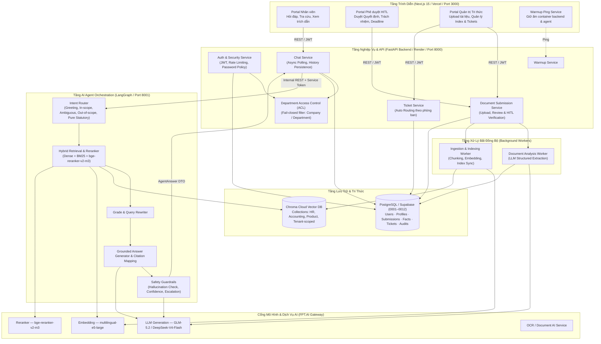
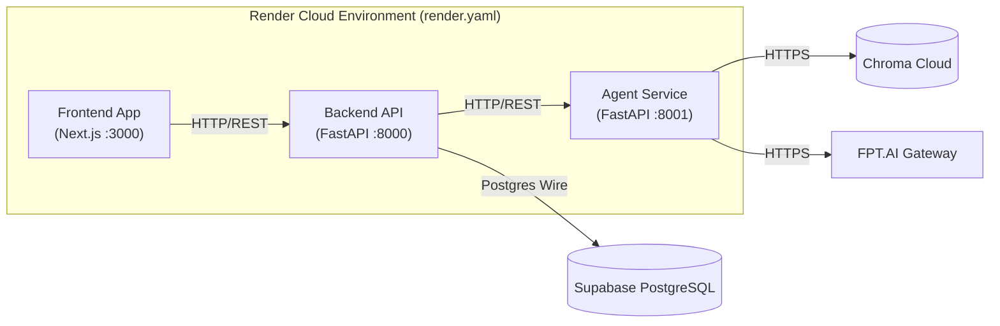

# Tài Liệu Kiến Trúc Hệ Thống (Architecture Document) — P-153

> **AI Agent Tóm tắt và Trích xuất Tri thức Tài liệu Nội bộ Đa Phòng ban (Enterprise Doc Intelligence Agent)**
> **VinUni AI20K Build Phase — Cohort 3 (Project P-153)**

---

## 1. Tổng Quan Hệ Thống (System Overview)

Hệ thống **Enterprise Doc Intelligence Agent (P-153)** giải quyết toàn diện bài toán quản trị, khai thác và tra cứu tri thức nội bộ đa phòng ban (Quy chế, Quy trình, Biên bản họp, Quyết định, Tài liệu Kế toán - Tài chính, Tài liệu Sản phẩm, v.v.). Hệ thống được xây dựng trên nền tảng **LangGraph**, phục vụ thông qua **FastAPI Backend**, giao diện web **Next.js 15**, cơ sở dữ liệu quan hệ **Supabase PostgreSQL**, và cơ sở dữ liệu vector đa miền **Chroma Cloud**.

### Năng lực cốt lõi:
1. **Document Ingestion & OCR:** Tiếp nhận tài liệu số (PDF, DOCX, scan) với pipeline chuẩn hóa văn bản, bóc tách và trích xuất OCR.
2. **Trích xuất thông tin có cấu trúc (Structured Extraction):** Bóc tách chính xác các trường dữ liệu hành động (*Quyết định*, *Trách nhiệm*, *Thời hạn*) theo schema Pydantic được xác thực bởi LLM.
3. **Quy trình Phê duyệt có con người (Human-in-the-Loop - HITL):** Giao diện và API cho phép Quản trị viên/Chuyên viên review, chỉnh sửa và phê duyệt bài nộp tài liệu trước khi chính thức nạp vào vector database.
4. **Hỏi đáp & Tổng hợp xuyên tài liệu (Cross-document QA):** Tìm kiếm lai (Hybrid Search: Dense Vector + BM25) kết hợp Reranker `bge-reranker-v2-m3` và suy luận đa chặng, đảm bảo 100% câu trả lời có trích dẫn nguồn (Citations).
5. **Phân quyền & Cô lập tri thức (Department-based Access Control - ACL):** Phân quyền truy cập theo phòng ban (`HR`, `Accounting`, `Product`, `Operations`, `General` + `Company-wide Scope`) với nguyên tắc fail-closed.
6. **Điều hướng Ticket & Escalation:** Tự động phát hiện các yêu cầu cần can thiệp cá nhân hoặc ngoài phạm vi để điều hướng mở Ticket đến đúng phòng ban xử lý.
7. **Kiểm soát chi phí & Quản lý Token:** Cảnh báo giới hạn token và áp dụng chiến lược tóm tắt phân tầng cho tài liệu dài.

---

## 2. Sơ Đồ Kiến Trúc Tổng Thể (Architecture Diagram)

---

## 3. Chi Tiết Các Thành Phần Hệ Thống (Components)

### 3.1. Frontend Web App (Next.js 15)
- **Công nghệ:** Next.js 15, React 19, TypeScript, CSS Modules.
- **Trạng thái:** Đã hoàn thiện và tích hợp đầy đủ trên nhánh `develop`.
- **Tính năng chính:**
  - **Authentication & Role Selection:** Đăng nhập, đăng ký với lựa chọn phòng ban công tác (`hr`, `accounting`, `product`, `operations`, `general`).
  - **Employee Knowledge Portal:** Giao diện chat trực quan, hỗ trợ hội thoại nhiều lượt, hiển thị rõ ràng trích dẫn nguồn (Citations) và các cảnh báo nguồn tài liệu.
  - **Document Review HITL Portal ([`DocumentReview.tsx`](file:///d:/AI%20Engineer/VIN%20AI/P-153/frontend/components/DocumentReview.tsx)):** Giao diện chuyên biệt cho Quản trị viên/Chuyên viên duyệt các tài liệu mới nạp, xem và sửa đổi các trường thông tin bóc tách cấu trúc (*Quyết định*, *Trách nhiệm*, *Thời hạn*).
  - **Ticket Management Portal ([`TicketsView.tsx`](file:///d:/AI%20Engineer/VIN%20AI/P-153/frontend/components/TicketsView.tsx)):** Quản lý các yêu cầu hỗ trợ được tự động điều hướng từ các câu hỏi cần xử lý cá nhân.
  - **Warmup Ping Service ([`WarmupPing.tsx`](file:///d:/AI%20Engineer/VIN%20AI/P-153/frontend/components/WarmupPing.tsx)):** Tự động phát tín hiệu kiểm tra định kỳ giữ ấm cho container backend và agent service trên cloud free tier.

### 3.2. Backend API Service (FastAPI)
- **Công nghệ:** FastAPI, Python 3.11+, SQLAlchemy 2.0 (asyncpg), Pydantic v2.
- **Port:** `8000`.
- **Module nghiệp vụ chính:**
  - **Auth & RBAC:** Xác thực bảo mật (`public.users`, `public.profiles`), băm mật khẩu chuẩn PBKDF2/bcrypt, phát JWT token, và kiểm soát chính sách mật khẩu (tối thiểu 8 ký tự, rate limit đăng nhập).
  - **Chat API:** Nhận truy vấn chat, quản lý session hội thoại, gọi sang Agent Service qua kết nối nội bộ có ký định danh (`X-Service-Token` + HMAC Signature), lưu trữ lịch sử tin nhắn và trích dẫn.
  - **Document Submissions API ([`document_submissions.py`](file:///d:/AI%20Engineer/VIN%20AI/P-153/backend/app/api/v1/endpoints/document_submissions.py)):** Tiếp nhận tài liệu upload, kích hoạt phân tích cấu trúc, cung cấp API lấy danh sách chờ duyệt, duyệt bài (`/approve`) hoặc từ chối (`/reject`).
  - **Department Access Control ([`access_control.py`](file:///d:/AI%20Engineer/VIN%20AI/P-153/backend/app/services/access_control.py)):** Áp dụng bộ lọc phân quyền tri thức theo phạm vi phòng ban và cấp độ bảo mật (`COMPANY_WIDE`, `DEPARTMENT_SPECIFIC`).
  - **Ticket Service ([`ticket_service.py`](file:///d:/AI%20Engineer/VIN%20AI/P-153/backend/app/services/ticket_service.py)):** Tự động tạo và điều phối ticket tới đúng phòng ban chuyên trách khi nhận tín hiệu escalation từ Agent.

### 3.3. AI Agent Service (LangGraph Orchestration)
- **Công nghệ:** LangGraph, LangChain, FPT.AI LLM Gateway.
- **Port:** `8001`.
- **Trạng thái:** Stateless (không tự lưu session, nhận context qua request body).
- **Luồng xử lý 12 node:**
  1. `condense`: Viết lại câu hỏi độc lập dựa trên lịch sử hội thoại nhiều lượt.
  2. `router`: Phân loại ý định người dùng (`greeting`, `in_scope`, `ambiguous`, `out_of_scope_or_personal`, `pure_statutory`).
  3. `direct`: Trả lời chào hỏi hoặc câu hỏi thông thường.
  4. `clarify`: Đặt câu hỏi làm rõ khi truy vấn mơ hồ.
  5. `retrieve`: Tìm kiếm lai (Hybrid Search: Dense Vector + BM25) có áp dụng bộ lọc phân quyền phòng ban (ACL).
  6. `rerank`: Đánh giá và sắp xếp lại độ phù hợp của chunk bằng mô hình `bge-reranker-v2-m3`.
  7. `grade`: Kiểm tra mức độ đáp ứng thông tin của tài liệu retrieved.
  8. `rewrite`: Tự động viết lại truy vấn tìm kiếm nếu tài liệu chưa đủ thông tin (hỗ trợ tối đa retry loop).
  9. `generate`: Sinh câu trả lời ngôn ngữ tự nhiên, gắn trích dẫn nguồn có kiểm chứng.
  10. `hallucination_check`: Kiểm tra chéo mức độ trung thực của câu trả lời so với ngữ cảnh trích xuất.
  11. `confidence`: Tính toán điểm tin cậy tổng hợp dựa trên điểm reranker và kiểm tra ảo giác.
  12. `finalize` / `escalate_ticket`: Đóng gói kết quả `AgentAnswer` hoàn chỉnh hoặc kích hoạt tạo Ticket hỗ trợ.

### 3.4. Database & Vector Storage
- **PostgreSQL (Supabase):**
  - Quản lý toàn bộ cấu trúc dữ liệu với 12 migrations liên tục: `0001` (initial schema), `0002` (RLS recursion fix), `0003` (self-escalation guard), `0004` (agent state & evaluation runs), `0005` (vector metadata registry), `0006` (ticket audit), `0007` (idempotent RLS repair), `0008` (tenant source unique constraints), `0009` (performance indexes), `0010` (department roles & company scope), `0011` (classify existing documents), `0012` (document review workflow).
- **Chroma Cloud Vector Database:**
  - Lưu trữ các vector nhúng (1024 chiều) từ mô hình `multilingual-e5-large`.
  - Phân tách bộ sưu tập (Collections) theo miền tri thức và tenant: `hr_documents`, `accounting`, `product`, `tenant_nexatech_knowledge`.

---

## 4. Luồng Dữ Liệu & Quy Trình Nghiệp Vụ (Data Flow)

### 4.1. Quy trình Truy Vấn Tri Thức (Online QA Flow)
1. Người dùng gửi câu hỏi qua giao diện Web Next.js.
2. Backend xác thực JWT, lấy phòng ban của người dùng và chuyển tiếp yêu cầu đến Agent Service.
3. Agent thực hiện `condense` (nếu có lịch sử) → `router` phân loại.
4. Nếu là câu hỏi nghiệp vụ: `retrieve` tìm kiếm trong Chroma Cloud và BM25 với bộ lọc phòng ban (User chỉ thấy tài liệu `COMPANY_WIDE` hoặc tài liệu thuộc phòng ban của mình).
5. Reranker đánh giá điểm phù hợp → `grade` → `generate` sinh câu trả lời kèm `citations`.
6. `hallucination_check` đối chiếu câu trả lời với nguồn → `confidence` chấm điểm tin cậy.
7. Trả về `AgentAnswer` an toàn (đã redact PII và lọc Prompt Injection) cho Backend lưu trữ và hiển thị lên Frontend.

### 4.2. Quy trình Nạp & Phê Duyệt Tri Thức (Document Review Flow - HITL)
1. Quản trị viên tải file (PDF/DOCX) lên qua giao diện Web.
2. Backend lưu trữ tài liệu với trạng thái `PENDING_ANALYSIS` và kích hoạt Document Analysis Worker.
3. Worker sử dụng LLM trích xuất các trường thông tin có cấu trúc (*Quyết định*, *Trách nhiệm*, *Thời hạn*), cập nhật trạng thái `NEEDS_REVIEW`.
4. Chuyên viên nghiệp vụ truy cập giao diện Document Review, kiểm tra tính chính xác của các trường thông tin, chỉnh sửa nếu cần và bấm **Phê duyệt (Approve)**.
5. Sau khi được duyệt, tài liệu chuyển sang trạng thái `APPROVED` và kích hoạt Ingestion Worker để chunk, embed và nạp vào Chroma Cloud.

---

## 5. Kiến Trúc Triển Khai (Deployment Architecture)

Hệ thống đã có sẵn blueprint triển khai hoàn chỉnh tại [`render.yaml`](file:///d:/AI%20Engineer/VIN%20AI/P-153/render.yaml), hỗ trợ khởi tạo tự động toàn bộ 3 services (Frontend, Backend, Agent) kết nối đến cơ sở dữ liệu cloud.

---

## 6. Bảo Mật & Kiểm Soát Rủi Ro (Security & Governance)

- **Department-based ACL (Fail-closed):** Ngăn chặn hoàn toàn việc rò rỉ dữ liệu giữa các phòng ban. Mọi truy vấn mặc định chỉ được tiếp cận tài liệu chung toàn công ty (`COMPANY_WIDE`) và tài liệu thuộc đúng phòng ban của tài khoản đăng nhập.
- **Chống leo quyền (Privilege Escalation Defense):** Trigger cơ sở dữ liệu chặn người dùng tự thay đổi vai trò hoặc phòng ban khi đăng ký.
- **An toàn AI & Chống ảo giác (AI Safety & Guardrails):**
  - Loại bỏ các chuỗi nghi vấn Prompt Injection khỏi chunk dữ liệu trước khi nạp vào context LLM (`strip_injection`).
  - Tự động che dấu dữ liệu nhạy cảm PII (Email, Số điện thoại, CCCD) trước khi trả về người dùng (`redact_pii`).
  - Kiểm tra ảo giác 2 tầng (LLM Hallucination Judge + Reranker Confidence Gate).
