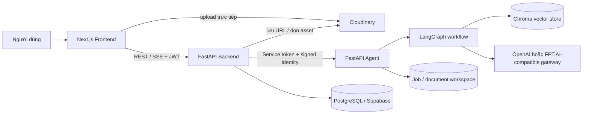

# P-153 — Enterprise Document Intelligence Agent

Hệ thống trợ lý tri thức nội bộ đa phòng ban, hỗ trợ nạp và kiểm duyệt tài liệu, hỏi đáp có dẫn nguồn, phân quyền truy cập, quản lý phiên bản và chuyển yêu cầu cần con người xử lý thành ticket.

> Hồ sơ được đối chiếu với nhánh `develop`, commit `87a85aa` ngày 2026-08-31. Báo cáo lịch sử được giữ để truy vết; trạng thái hiện tại được mô tả tại README và bộ tài liệu chuẩn bên dưới.

Mục lục bàn giao nhanh: [`docs/FINAL_SUBMISSION.md`](docs/FINAL_SUBMISSION.md).

## Dùng thử

**Bản demo: <https://enterprise-document-intelligence-unh1.onrender.com>**

Không cần đăng nhập: mở link, chọn một vai trò rồi đặt câu hỏi. Dữ liệu trong bản demo là dữ liệu mô phỏng.

| Vai trò | Câu hỏi nên thử | Điều sẽ thấy |
|---|---|---|
| Nhân viên Nhân sự | Nhân viên có bao nhiêu ngày phép năm? | Câu trả lời kèm trích dẫn; bấm vào nguồn để xem đoạn đối soát |
| Nhân viên Kế toán | Hạn mức duyệt chi của Giám đốc tài chính là bao nhiêu? | Đối chiếu nhiều tài liệu và nói rõ phần tài liệu không đề cập |
| Nhân viên Sản phẩm | Checkout Redesign có nên rollout 100% chưa? | Tổng hợp từ báo cáo thử nghiệm, kế hoạch release và roadmap |
| Nhân viên Nhân sự | Checkout Redesign có nên rollout 100% chưa? | Bị từ chối vì tài liệu thuộc phòng ban khác (phân quyền theo phòng ban) |

Giới hạn của bản demo:

- Hạ tầng dùng gói miễn phí nên lần mở đầu có thể mất khoảng 1 phút để máy chủ khởi động.
- Khách dùng quyền nhân viên, chỉ có Trợ lý AI và Ticket; các màn hình quản trị không mở công khai.
- Trích dẫn hiển thị đoạn đối soát, chưa mở được file PDF/DOCX gốc.
- Số lượt hỏi được giới hạn để bảo vệ quota model.

## 1. Bộ hồ sơ nộp cuối

| # | Hạng mục | Tài liệu / mã nguồn |
|---|---|---|
| 1 | Source code | [`src/`](src/), [`backend/`](backend/), [`frontend/`](frontend/), [`supabase/`](supabase/), [`tests/`](tests/), [`eval/`](eval/) |
| 2 | README | File này |
| 3 | Sơ đồ kiến trúc | [`ARCHITECTURE.md`](ARCHITECTURE.md), [`docs/architecture_diagram.md`](docs/architecture_diagram.md), [`docs/project/diagrams/`](docs/project/diagrams/) |
| 4 | Đặc tả & thiết kế | [`docs/SYSTEM_SPECIFICATION_AND_DESIGN.md`](docs/SYSTEM_SPECIFICATION_AND_DESIGN.md), [`docs/project/`](docs/project/) |
| 5 | Tài liệu kiểm thử | [`docs/TESTING.md`](docs/TESTING.md), [`docs/docs-final/references/E2E_TEST_MATRIX.md`](docs/docs-final/references/E2E_TEST_MATRIX.md), [`eval/`](eval/) |
| 6 | Nhật ký tuần | [`JOURNAL.md`](JOURNAL.md), [`WORKLOG.md`](WORKLOG.md) |

## 2. Phạm vi sản phẩm

### Năng lực đã có trong source

- Đăng ký, đăng nhập, refresh token và phân quyền `EMPLOYEE`, `DEPARTMENT_MANAGER`, `SUPER_ADMIN`.
- Hội thoại nhiều lượt qua polling hoặc Server-Sent Events (SSE), lưu lịch sử và khôi phục request bị gián đoạn.
- LangGraph Agent thực hiện condense + intent routing, boundary, retrieval, grading, rewrite, generation, confidence/hallucination guard và escalation.
- Hybrid retrieval gồm dense vector, BM25, reciprocal-rank fusion và rerank; hỗ trợ HR, Accounting, Product và dữ liệu toàn công ty.
- Trích dẫn theo tài liệu, trang/sheet, mục, phiên bản và ngày hiệu lực; UI mở và highlight DOCX/PDF.
- Department ACL và tenant isolation theo nguyên tắc fail-closed.
- Upload PDF, DOCX, XLSX, Markdown và ảnh; tài liệu scan có thể đi qua VLM/OCR.
- Human-in-the-Loop: nộp tài liệu, phân tích có cấu trúc, duyệt/từ chối, xuất bản và index.
- Quản lý vòng đời tài liệu: metadata, version, soft archive và vô hiệu hóa vector chunks của phiên bản cũ.
- Ticket routing, index rebuild, evaluation jobs, audit log và quản trị quyền truy cập.
- Mở rộng truy vấn thời gian, giải tham chiếu hội thoại và đối soát nhiều nguồn.

### Chưa coi là hoàn tất

- Trang “Giám sát truy vấn” hiện là placeholder, chưa có dashboard vận hành thật.
- Kiểm thử live phụ thuộc Supabase, Chroma Cloud và model gateway; cần credential/môi trường hợp lệ để chạy lại.
- Kết quả kiểm thử và giới hạn môi trường được ghi tại [`docs/TESTING.md`](docs/TESTING.md).

## 3. Kiến trúc tóm tắt



Luồng và ranh giới trách nhiệm chi tiết nằm trong [`ARCHITECTURE.md`](ARCHITECTURE.md).

## 4. Công nghệ

| Thành phần | Công nghệ |
|---|---|
| Frontend | Next.js 15, React 19, TypeScript, PDF.js, docx-preview |
| Backend | FastAPI, Pydantic, SQLAlchemy async, PostgreSQL/Supabase, JWT |
| Agent | LangGraph, hybrid RAG, BM25, Chroma, model gateway OpenAI-compatible |
| Ingestion | PDF/DOCX/XLSX/Markdown/image extraction, VLM/OCR, structure-aware chunking |
| Quality | Pytest, Ruff, ESLint, TypeScript, evaluation datasets và GitHub Actions |
| Deploy | Docker Compose, Render (static site cho Frontend, web service cho Backend và Agent), Supabase, Chroma Cloud |

## 5. Cấu trúc repository

```text
P-153/
├── src/                    # Agent, retrieval, ingestion, security, workers
├── backend/                # Public API, auth/RBAC, chat, documents, tickets
├── frontend/               # Next.js application
├── supabase/migrations/    # PostgreSQL migrations 0001–0012
├── tests/                  # Agent/core, security, worker và E2E tests
├── backend/tests/          # Backend API/service tests
├── eval/                   # Datasets, runners, metrics và kết quả lịch sử
├── scripts/                # Ingestion, migration, verification và utilities
├── docs/                   # Kiến trúc, đặc tả, thiết kế và kiểm thử
├── ARCHITECTURE.md         # Tài liệu kiến trúc chuẩn
├── JOURNAL.md              # Nhật ký theo tuần
├── WORKLOG.md              # Nhật ký dựng từ commit develop
├── docker-compose.yml      # Môi trường local 3 service
└── render.yaml             # Blueprint triển khai cloud
```

## 6. Chạy hệ thống

### Yêu cầu

- Docker Desktop + Docker Compose; hoặc Python 3.11+, Node.js 20+ và pnpm 9.
- PostgreSQL/Supabase và Chroma local/cloud.
- Một model gateway được cấu hình: OpenAI hoặc FPT.AI-compatible.

### Docker Compose

```bash
git clone https://github.com/luongducthangDS/Enterprise-Document-Intelligence.git
cd Enterprise-Document-Intelligence
cp .env.example .env
docker compose up --build
```

| Dịch vụ | Địa chỉ local |
|---|---|
| Frontend | <http://localhost:3000> |
| Backend Swagger | <http://localhost:8000/docs> |
| Backend health | <http://localhost:8000/health> |
| Agent | Chạy nội bộ trong Compose; khi chạy riêng có thể bind cổng 8001 |

### Chạy riêng từng service

```bash
# Agent
python -m venv .venv
source .venv/bin/activate          # Windows: .venv\Scripts\activate
pip install -r requirements.txt
uvicorn src.main:app --host 0.0.0.0 --port 8001

# Backend
pip install -r backend/requirements.txt
cd backend
uvicorn main:app --host 0.0.0.0 --port 8000

# Frontend
cd frontend
pnpm install --frozen-lockfile
pnpm dev
```

## 7. Cấu hình chính

Không commit `.env` hoặc secret thật. Dùng [`.env.example`](.env.example) làm mẫu.

| Nhóm | Biến tiêu biểu |
|---|---|
| Database/Auth | `DATABASE_URL`, `JWT_SECRET_KEY`, `ACTIVE_TENANT` |
| Agent contract | `AI_AGENT_SERVICE_URL`, `AI_AGENT_SERVICE_TOKEN`, `AGENT_SERVICE_TOKEN` |
| Vector store | `VECTOR_DB_BACKEND`, `CHROMA_CLOUD_API_KEY`, `CHROMA_CLOUD_TENANT`, `CHROMA_CLOUD_DATABASE` |
| Model provider | `LLM_PROVIDER`, `USE_GLM`, `OPENAI_API_KEY`, `FPT_API_KEY` |
| Retrieval | `USE_HYBRID`, `RETRIEVAL_TOP_K`, rerank và confidence settings |
| File storage | `CLOUDINARY_CLOUD_NAME`, `CLOUDINARY_API_KEY`, `CLOUDINARY_API_SECRET` |

## 8. Kiểm thử

```bash
# Agent/core
pytest tests -q
ruff check src tests

# Backend
cd backend
pytest tests -q
ruff check app tests

# Frontend
cd frontend
pnpm lint
pnpm typecheck
pnpm build
```

Không diễn giải test live là test offline. Ma trận, dependency và kết quả kiểm chứng ngày 2026-09-01 nằm tại [`docs/TESTING.md`](docs/TESTING.md). Báo cáo metrics cuối để mentor review nằm tại [`eval/results/report.md`](eval/results/report.md). Bộ bốn tài liệu bàn giao đã được đóng gói tại [`docs/docs-final/`](docs/docs-final/).

## 9. Nhóm phát triển và truy vết đóng góp

| Thành viên | Git author trên `develop` | Phạm vi thể hiện qua commit |
|---|---|---|
| Giang Minh Phú | `minhphu711` | Team lead/backend, integration, evaluation, security, tài liệu |
| Hoàng Thanh Sơn | `hthanhson` | Backend, system design, integration, performance, UI/Agent fixes |
| Hoàng Thái Dương | `duong` | Frontend và workflow UI |
| Lương Đức Thắng | `luongducthangws` | AI/RAG, data, evaluation, security và quality audit |

Chi tiết theo ngày/commit: [`WORKLOG.md`](WORKLOG.md).
