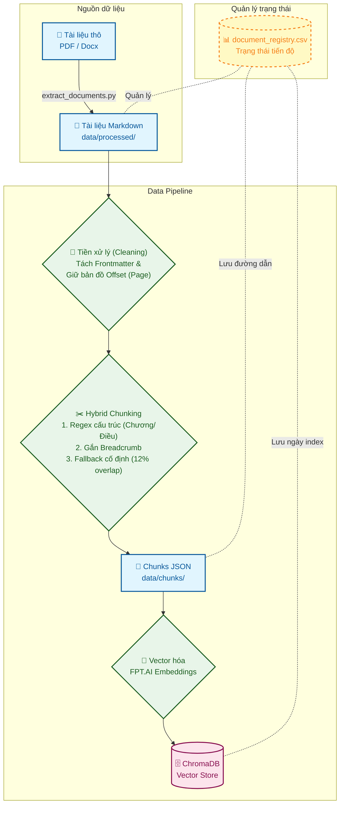
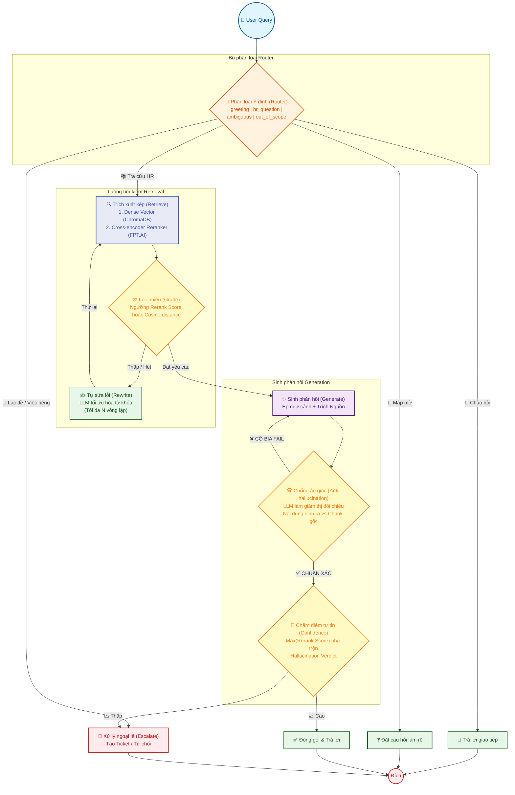

# 🚀 Kiến trúc Pipeline Chi Tiết (P-153)

Tài liệu này đi sâu vào cơ chế hoạt động, cấu trúc dữ liệu và các quyết định thiết kế (Design Decisions) đằng sau hai luồng chính của dự án: **Data Ingestion Pipeline** và **Agentic RAG Pipeline**.

---

## 1. 🗄️ Data Ingestion Pipeline (Luồng Xử lý Dữ liệu)

Mục tiêu của luồng này là chuyển đổi các tài liệu thô thành các vector embeddings chất lượng cao, giữ nguyên được cấu trúc pháp lý (Chương/Điều) và metadata để phục vụ cho trích dẫn (Citations) chính xác.



### 1.1. Quản lý trạng thái (Document Registry)
Toàn bộ quá trình Ingestion không chạy lộn xộn mà được điều phối thông qua file `data/metadata/document_registry.csv`. 
File này đóng vai trò như một cơ sở dữ liệu State, theo dõi từng file tài liệu với các trường:
- `source_file`: Tên file gốc (vd: `bo_luat_lao_dong_2019.pdf`).
- `status`: Trạng thái (đã processed hay chưa).
- `chunks_path`: Đường dẫn tới file JSON chứa chunk của tài liệu này (cập nhật sau khi chunking).
- `indexed_at`: Thời gian (timestamp) tài liệu được đẩy lên VectorDB. 
*Quy trình này giúp Pipeline có thể chạy nối tiếp (resume) dễ dàng, chỉ xử lý những file mới hoặc bị thay đổi thay vì chạy lại từ đầu.*

### 1.2. Làm sạch & Tiền xử lý (Cleaning - `cleaners.py`)
Tài liệu Markdown thô sẽ được đọc và tách làm hai phần:
- **Frontmatter**: Trích xuất các siêu dữ liệu cấu hình sẵn (như Tên văn bản, Mã số, Người ký, Loại chính sách: template hay official).
- **Text body**: Làm sạch các ký tự không hợp lệ, loại bỏ các dòng trắng dư thừa, nhưng **VẪN GIỮ LẠI BẢN ĐỒ OFFSET** (ánh xạ giữa ký tự hiện tại và số trang ban đầu của file PDF) để sau này RAG có thể trích dẫn chính xác "trang số mấy".

### 1.3. Phân đoạn thông minh (Hybrid Chunking - `chunkers.py`)
Đây là khâu quan trọng nhất quyết định chất lượng Retrieve:
- **Tách theo cấu trúc (Structure-based)**: Không chặt văn bản một cách cơ học mỗi 1000 ký tự. Hệ thống sử dụng Regex để nhận diện `Chương X`, `Mục Y`, `Điều Z`. 
- **Lưu trữ Breadcrumb**: Khi chia cắt một Điều luật, nó gắn kèm đường dẫn hệ thống. Ví dụ, chunk nội dung của Điều 5 sẽ được đính kèm đoạn text: `Chương II > Mục 1 > Điều 5` vào trước nội dung. Điều này giúp Vector Embedding chứa đủ ngữ cảnh kể cả khi đứng độc lập.
- **Merge/Split**: Các thẻ tiêu đề (Chương, Mục) thường quá ngắn và vô nghĩa nếu đứng một mình -> Thuật toán sẽ tự động gộp (merge) chúng vào nội dung bên dưới. Các nội dung quá dài sẽ bị cắt cẩn thận theo ranh giới câu.
- **Fallback**: Đối với tài liệu không có format Chương/Điều, hệ thống lùi về cắt theo độ dài cố định nhưng có **overlap (khoảng 12%)**. Đặc biệt, nó lùi về khoảng trắng gần nhất để không bao giờ cắt vỡ đôi 1 từ Tiếng Việt (Ví dụ: tránh cắt thành "Ng" và "ười lao động").

### 1.4. Nhúng & Lưu trữ (Embedding & Indexing)
- Mỗi Chunk được chuyển thành Vector nhờ mô hình **Embedding của FPT.AI**.
- Lưu vào **ChromaDB** kèm Metadata dạng Key-Value (rất quan trọng cho filter):
  ```json
  {
      "chunk_id": "bo_luat_lao_dong::0145",
      "source_file": "bo_luat_lao_dong.pdf",
      "title": "Bộ luật Lao động 2019",
      "chapter": "Chương III",
      "article": "Điều 15",
      "page_start": 12,
      "is_official_policy": true
  }
  ```

---

## 2. 🤖 Agentic RAG Pipeline (Luồng Trợ lý Thông minh)

Pipeline sử dụng `LangGraph` định nghĩa một State Machine (máy trạng thái). Thay vì chỉ Retrieve rồi Generate 1 lần duy nhất, Agent có vòng lặp tự sửa lỗi, tự kiểm duyệt và chuyển tiếp yêu cầu của con người.



### 2.1. Quản lý trạng thái (AgentState)
Toàn bộ hành trình của một câu hỏi được chia sẻ chung qua object `AgentState`:
- `query` (str): Câu hỏi gốc.
- `intent` (str): Ý định người dùng (từ Router).
- `rewritten_query` (str): Câu hỏi đã được Agent tối ưu lại.
- `retrieved_chunks` (list): Danh sách các chunks lấy được từ DB.
- `generated_answer` (str): Câu trả lời LLM sinh ra.
- `hallucination_passed` (bool): Đã vượt qua vòng kiểm duyệt bịa đặt chưa.
- `confidence_score` (float): Điểm tự tin (từ 0.0 - 1.0).

### 2.2. Phân loại thông minh (Router Node)
Sử dụng LLM prompt mạnh mẽ để nhận diện 4 luồng chính:
- `greeting`: Người dùng chỉ chào hỏi ("Hi bạn") -> Bỏ qua RAG, trả lời giao tiếp mượt mà.
- `ambiguous`: Câu hỏi tối nghĩa (Ví dụ: "Nghỉ thì tính sao" - không rõ nghỉ phép, nghỉ ốm, thai sản hay nghỉ việc). RAG sẽ không đoán mò mà đặt câu hỏi làm rõ (Clarify Node) để user bổ sung thông tin.
- `out_of_scope_or_personal`: Câu hỏi đòi hỏi dữ liệu riêng tư ("Lương tôi tháng này bao nhiêu?") hoặc hỏi về chính sách của công ty đối thủ (FPT, Viettel...).
- `hr_question`: Câu hỏi chính sách hợp lệ.

### 2.3. Trích xuất kép (Retrieval & Rerank)
- **Dense Retrieval**: Biến query thành Vector, lấy Top K tài liệu gần nhất từ ChromaDB. Điểm yếu của bước này là đôi khi nó lấy nhầm tài liệu có chứa từ khóa gần giống nhưng không trả lời đúng trọng tâm.
- **Cross-Encoder Reranker (FPT.AI)**: Đây là chốt chặn cực mạnh. Thay vì đo Vector distance, mô hình đọc từng cặp `(Câu hỏi, Nội dung chunk)` để chấm điểm độ tương quan từ 0 - 1. Kết quả được sắp xếp lại, loại bỏ các kết quả nhiễu (Grade Node).

### 2.4. Tự khắc phục lỗi (Rewrite Node)
Nếu sau bước Reranker và Grade không còn Chunk nào vượt qua điểm sàn (hoặc nội dung quá tệ), Agent không chịu bỏ cuộc ngay.
- Nó kích hoạt `Rewrite Node`: Dùng LLM viết lại (rephrase) câu hỏi dựa trên câu hỏi gốc. Nó sẽ thử bổ sung thêm ngữ cảnh và thử lại Retrieval (Loop 1 lần).

### 2.5. Sinh phản hồi & Chống ảo giác (Generate & Hallucination Check)
- **Generate**: LLM nhận danh sách các chunks và bị cấm không được mang kiến thức thế giới bên ngoài vào. Phải dùng format `[Nguồn 1]`. Đặc biệt, Prompt sẽ đánh dấu rõ tài liệu nào là chính sách thật, tài liệu nào chỉ là Template (để LLM cảnh báo người dùng).
- **Hallucination Check**: Sau khi sinh xong câu trả lời, nó không trả về ngay. Một prompt khác (hoạt động như giám thị) sẽ đọc lại câu trả lời và so sánh ngược với văn bản gốc.
  - Nếu câu trả lời có số liệu `30 ngày` mà văn bản gốc chỉ ghi `15 ngày` -> Đánh dấu `FAIL`, ép vòng lại Generate Node (sửa lại).
  - Nếu `PASS` -> Đi tiếp.

### 2.6. Điểm Tự tin & Escalation (Confidence & Escalate Node)
- **Tính Confidence**: Điểm tự tin là sự pha trộn giữa điểm Reranker cao nhất và kết quả kiểm tra Hallucination. (Nếu Hallucination Fail liên tục, Confidence bị hạ thẳng xuống 0.3).
- **Escalate (Luân chuyển con người)**: 
  - Nếu tự tin quá thấp (bot không chắc chắn) hoặc câu hỏi đòi hỏi thông tin cá nhân hệ thống sẽ kích hoạt tạo Ticket.
  - Bot sẽ tham chiếu file `data/metadata/ticket_routing_rules.json` để đọc Keyword (Ví dụ user nhắc từ "lương", "thuế" -> chuyển cho phòng `C&B` (Compensation & Benefits); từ "kỷ luật" -> chuyển `Employee Relations`).
  - Riêng với câu hỏi về chính sách công ty đối thủ, Bot sẽ có 1 rule từ chối cứng lịch sự chứ không mất công tạo Ticket cho nhân sự nội bộ giải quyết.
