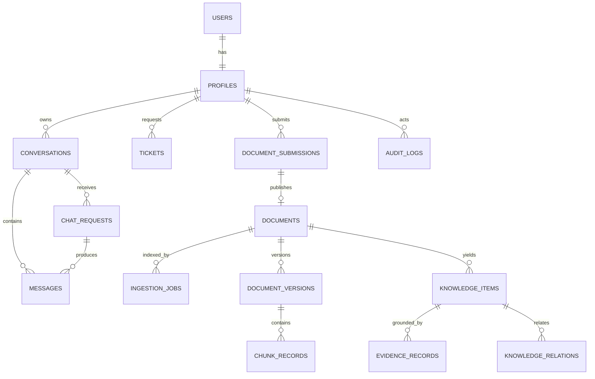

# Đặc tả và thiết kế hệ thống P-153

**Tên sản phẩm:** Enterprise Document Intelligence Agent
**Baseline:** `develop@87a85aa`
**Ngày đối chiếu:** 2026-09-01
**Trạng thái:** Tài liệu chuẩn dùng cho bàn giao

## 1. Mục đích và phạm vi

Hệ thống giúp nhân viên tra cứu tài liệu nội bộ bằng ngôn ngữ tự nhiên, nhận câu trả lời có thể đối soát; giúp quản lý phòng ban kiểm duyệt tài liệu và xử lý ticket; giúp quản trị viên quản lý quyền, chỉ mục và đánh giá chất lượng.

Ngoài phạm vi hiện tại: tư vấn pháp luật thuần túy, truy cập dữ liệu cá nhân live không được cấp, dashboard monitoring production hoàn chỉnh và tự động xuất bản tri thức mà không qua phê duyệt.

## 2. Tác nhân

| Actor | Mục tiêu | Ràng buộc |
|---|---|---|
| Employee | Chat, xem citation, quản lý conversation và ticket cá nhân | Chỉ thấy dữ liệu toàn công ty hoặc dữ liệu được phép theo phòng ban |
| Department Manager | Quản lý tài liệu/ticket trong phòng ban | Không được tự mở rộng sang phòng ban khác |
| Super Admin | Quản trị user/access, audit, index, evaluation | Các thao tác đặc quyền phải được xác thực và ghi vết |
| Backend service | Sở hữu identity và dữ liệu nghiệp vụ | Chỉ gọi Agent bằng service token + signed identity |
| Agent service | Truy xuất, suy luận và chạy worker | Không tin identity trực tiếp từ client; không tự persist ticket nghiệp vụ |

## 3. Yêu cầu chức năng

| ID | Yêu cầu | Acceptance criteria | Thành phần triển khai |
|---|---|---|---|
| FR-01 | Đăng ký/đăng nhập | Email hợp lệ; role mặc định Employee; department thuộc danh mục hoạt động; cấp access/refresh token | `backend/app/api/v1/endpoints/auth.py`, `auth_service.py` |
| FR-02 | Phân quyền người dùng | Chỉ Super Admin sửa role/access; không hạ quyền Super Admin cuối cùng | `admin.py`, `access_control.py` |
| FR-03 | Quản lý hội thoại | Tạo, liệt kê, đổi tên, xóa/kết thúc conversation; đọc messages theo owner | `conversations.py`, `conversation_service.py` |
| FR-04 | Chat có dẫn nguồn | Nhận query, dùng history, trả answer/runtime state/citations; hỗ trợ polling và SSE | `chat.py`, `chat_service.py`, `src/api/routes.py` |
| FR-05 | Câu hỏi nhiều lượt | Condense query và giải đại từ/cụm chỉ định từ history trước retrieval | `src/agents/nodes/router.py` |
| FR-06 | Định tuyến an toàn | Greeting/capability/ambiguous/pure statutory/personal/knowledge đi đúng nhánh | `src/agents/graph.py`, `router.py`, `boundary.py` |
| FR-07 | Truy xuất lai | Kết hợp dense + BM25 + RRF + rerank; mở rộng truy vấn thời gian | `src/agents/nodes/retrieval.py`, `src/retrieval/` |
| FR-08 | ACL tri thức | Áp tenant, role, department, scope, lifecycle trước khi đưa chunk cho LLM; deny khi không hợp lệ | `src/security/`, `backend/app/services/access_control.py` |
| FR-09 | Grounding | Answer nghiệp vụ phải gắn citation; kiểm tra số liệu, confidence và hallucination trước finalize | `generation.py`, `escalation.py` |
| FR-10 | Escalation | Thiếu bằng chứng/dữ liệu cá nhân/độ tin cậy thấp tạo ticket draft; Backend persist theo quyền | `escalation.py`, `ticket_service.py` |
| FR-11 | Upload tài liệu | Manager/Admin upload file hoặc gửi public URL; validate type/size/department/scope | `documents.py`, `document_submissions.py` |
| FR-12 | Phân tích tài liệu | Extract, clean, chunk, nhận diện metadata và trích xuất dữ liệu cấu trúc | `src/ingestion/`, `src/workers/document_analysis.py` |
| FR-13 | HITL review | Người có quyền xem kết quả, sửa metadata và approve/reject | `DocumentReview.tsx`, `document_submission_service.py` |
| FR-14 | Version lifecycle | Khi xuất bản bản mới, giữ lịch sử và loại chunks phiên bản cũ khỏi retrieval | `document_service.py`, `src/ingestion/indexer.py` |
| FR-15 | Citation viewer | Mở nguồn, hiển thị version/location và highlight nội dung liên quan | `DocumentViewer.tsx`, `citation_service.py` |
| FR-16 | Index job | Tạo index rebuild và theo dõi trạng thái | `indexes.py`, `index_service.py`, `src/workers/indexing.py` |
| FR-17 | Evaluation job | Chạy dataset cấu hình, lưu metrics và quality gate | `evaluation.py`, `evaluation_service.py`, `src/workers/evaluation.py` |
| FR-18 | Audit | Ghi và truy xuất thay đổi quyền/tri thức theo actor | `admin.py`, `knowledge.py`, domain audit models |

## 4. Yêu cầu phi chức năng

| ID | Thuộc tính | Yêu cầu / thiết kế đáp ứng |
|---|---|---|
| NFR-01 | Security | JWT, password hashing, service token, signed identity, RBAC, department ACL, PII redaction |
| NFR-02 | Reliability | Chat request/job có state machine; recover pending/stale work sau restart; retry có giới hạn |
| NFR-03 | Traceability | Request ID, citation metadata, audit log, version và source location |
| NFR-04 | Performance | SSE, unified condense-router, cached embedding/BM25, startup warmup, confidence fast path |
| NFR-05 | Maintainability | Tách Frontend/Backend/Agent; API schemas; domain modules; provider abstraction |
| NFR-06 | Portability | Dockerfiles, Compose, Render blueprint, local/cloud vector backend |
| NFR-07 | Testability | Unit/integration/E2E/evaluation datasets; dependency injection và test database |
| NFR-08 | Privacy | Không log secret; audit dependency/secret trong CI; không đưa unauthorized chunks vào prompt |

## 5. Thiết kế API

Base public API: `/api/v1` trên Backend.

| Nhóm | Endpoint tiêu biểu | Quyền |
|---|---|---|
| Auth | `POST /auth/register`, `/login`, `/refresh`, `GET /auth/me` | Public/token |
| Conversations | CRUD `/conversations`, messages, end | Authenticated owner |
| Chat | `POST /chat/requests`, `/requests/stream`, status, retry | Authenticated |
| Citations | `GET /citations/{id}` | Authenticated + document ACL |
| Tickets | create/list/detail/update | Owner/department manager/admin |
| Documents | upload/from-url/list/detail/metadata/archive/public-url | Manager/Admin với department scope |
| Review | submission CRUD, approve/reject | Manager/Admin với department scope |
| Operations | index rebuild, ingestion status, evaluation run | Manager/Admin; evaluation là Super Admin |
| Access | users/access model/audit logs | Super Admin |
| Knowledge | items, relations, approve/reject/edit, audit | Manager/Admin theo scope |

Internal Agent API:

| Endpoint | Chức năng |
|---|---|
| `POST /api/v1/agent/query` | Đồng bộ một query |
| `POST /api/v1/agent/query/stream` | SSE progress + final answer |
| `POST /api/v1/agent/jobs/ingestion` | Parse/chunk/embed/index tài liệu |
| `POST /api/v1/agent/jobs/document-analysis` | Phân tích tài liệu trong review area |
| `POST /api/v1/agent/jobs/index-rebuild` | Rebuild chỉ mục |
| `POST /api/v1/agent/jobs/evaluation` | Chạy evaluation |
| `GET /api/v1/agent/jobs/{job_id}` | Poll state/stage/progress/result |

## 6. Mô hình dữ liệu logic



Trong code tồn tại lớp model nghiệp vụ backend và lớp knowledge model phục vụ quản trị tri thức. Database migration là nguồn chuẩn khi triển khai schema thật.

## 7. State machines

### Chat request

```text
QUEUED / GENERATING → COMPLETED | REFUSED | FAILED
FAILED → retry mới (giới hạn theo service)
```

Frontend nhận trạng thái qua SSE; nếu stream lỗi có thể dùng polling để lấy final state từ Backend.

### Document submission

```text
ANALYZING (stage: UPLOADED → extract/chunk/index staging)
  ├─→ PENDING_REVIEW
  │     ├─→ APPROVING → PUBLISHING → PUBLISHED
  │     └─→ REJECTED
  └─→ ANALYSIS_FAILED

APPROVING / PUBLISHING ─→ PUBLISH_FAILED khi xuất bản lỗi
```

Các state trên khớp `document_submission_service.py` và migration `0012_document_review_workflow.sql`. Invariant là: chỉ tài liệu ở nhánh đã approve mới được chuyển từ staging sang corpus chính thức.

### Agent worker job

```text
QUEUED → PROCESSING → SUCCEEDED | FAILED
```

Progress gồm `stage`, `progress_percent`, `result/error` và `poll_after_ms`.

## 8. Thiết kế bảo mật

1. Client gửi JWT tới Backend, không gọi Agent trực tiếp.
2. Backend lấy identity từ token/database, không tin role do client truyền.
3. Backend gọi Agent bằng service token và chữ ký identity.
4. Retrieval dựng filter tenant/role/department/scope/lifecycle.
5. Metadata chunk được kiểm tra lại trước generation.
6. Finalize loại citation không dùng và che PII.
7. Unknown role/scope/department phải fail closed.

## 9. Thiết kế ingestion và versioning

```text
File/URL
  → extractor (PDF/DOCX/XLSX/MD/image)
  → cleaner + page/sheet location map
  → structure-aware chunker
  → metadata/lifecycle normalization
  → embedding
  → Chroma upsert
```

Khi xuất bản phiên bản mới, Backend truyền `previous_source_stem` và version cho worker. Indexer đánh dấu chunks cũ không còn eligible trước khi upsert chunks mới, nhờ đó citation vẫn truy vết được lịch sử nhưng retrieval chỉ dùng bản hoạt động.

## 10. Thiết kế UI theo vai trò

| Màn hình | Employee | Manager | Super Admin |
|---|:---:|:---:|:---:|
| Chat / citations | ✓ | ✓ | ✓ |
| Ticket cá nhân | ✓ |  |  |
| Hàng đợi ticket |  | Theo phòng | Toàn hệ thống |
| Kho tài liệu / review |  | Theo phòng | Toàn hệ thống |
| Index |  | Theo quyền | ✓ |
| Access administration |  |  | ✓ |
| Evaluation |  |  | ✓ |
| Monitoring | Placeholder | Placeholder | Placeholder |

## 11. Traceability tài liệu

- Kiến trúc: [`../ARCHITECTURE.md`](../ARCHITECTURE.md)
- Sơ đồ: [`architecture_diagram.md`](architecture_diagram.md)
- API backend lịch sử: [`project/API/apiBackend.md`](project/API/apiBackend.md)
- Agent contract: [`AGENT_API.md`](docs-final/references/AGENT_API.md)
- Worker contract: [`AGENT_WORKERS.md`](docs-final/references/AGENT_WORKERS.md)
- Database: [`project/database/relationDB.md`](project/database/relationDB.md) và `supabase/migrations/`
- Kiểm thử: [`TESTING.md`](TESTING.md)

## 12. Giả định và giới hạn bàn giao

- NexaTech là tenant/demo persona, không phải tuyên bố về chính sách của một doanh nghiệp thật.
- Tài liệu lịch sử có thể chứa metric tại thời điểm cũ; chỉ dùng đúng timestamp/run ID của báo cáo.
- Live URL, credential và trạng thái deployment phải được xác nhận từ môi trường, không suy ra từ file cấu hình.
- Không tuyên bố “production ready” chỉ dựa trên việc có Docker/Render configuration.
- Luồng submission bằng URL cố ý đặt `file_content=None` (tệp nằm trên storage, chỉ giữ `public_url`). Migration `0012_document_review_workflow.sql` từng khai báo cột này `NOT NULL` khiến database tạo từ migration từ chối request dù test SQLite theo ORM vẫn pass; `0013_document_submission_content_nullable.sql` đã nới ràng buộc để schema khớp ORM và hành vi service.
