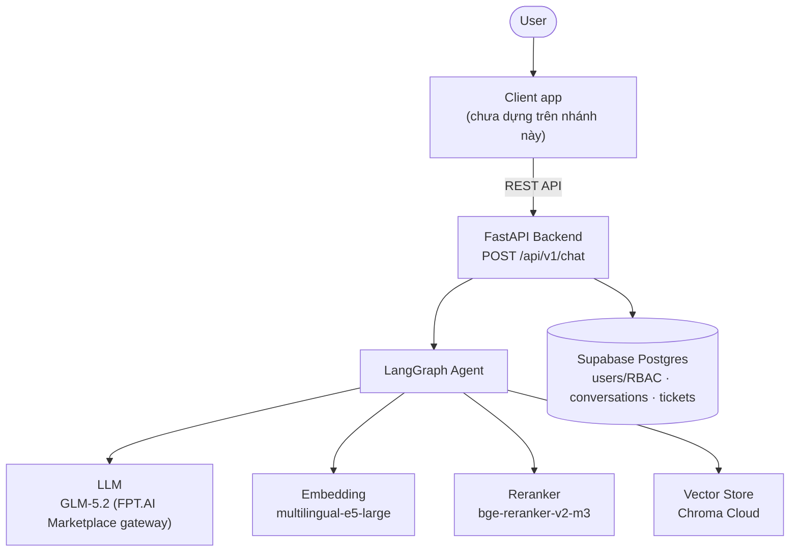
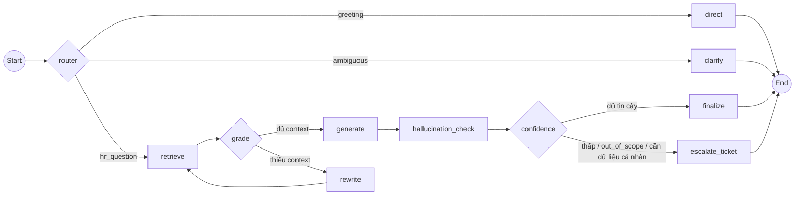
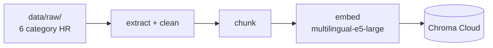

# Architecture Diagram

> Bản đầy đủ (component, quyết định thiết kế, số liệu đo): [`../ARCHITECTURE.md`](../ARCHITECTURE.md) và [`rag-pipeline/PIPELINE.md`](rag-pipeline/PIPELINE.md).

## System Overview

## Agent Flow (LangGraph, 11 node)

## Data Ingestion Flow (offline)

## Component Details

| Component | Technology | Purpose |
|-----------|-----------|---------|
| Client app | Chưa dựng trên nhánh này (bản demo thử nghiệm ở nhánh khác) | Giao diện chat cho nhân viên |
| Backend | FastAPI | API server, endpoint `/api/v1/chat` |
| Agent | LangGraph (11 node) | Orchestration: router → retrieve → grade → generate → hallucination-check → confidence → finalize/escalate |
| LLM | GLM-5.2 qua FPT.AI Marketplace (OpenAI-compatible gateway) | Sinh câu trả lời, phân loại intent |
| Embedding | multilingual-e5-large qua FPT.AI Marketplace | Vector hoá chunk và câu hỏi (prefix `passage:`/`query:`) |
| Reranker | bge-reranker-v2-m3 qua FPT.AI Marketplace | Xếp hạng lại top-k kết quả retrieval, làm cơ sở tính confidence |
| Vector Store | Chroma Cloud (cosine distance) | Lưu trữ embedding chunk cho RAG |
| Database | Supabase (Postgres + Auth/RLS) | Users/RBAC, lịch sử hội thoại, ticket |
