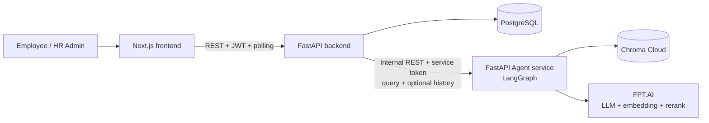
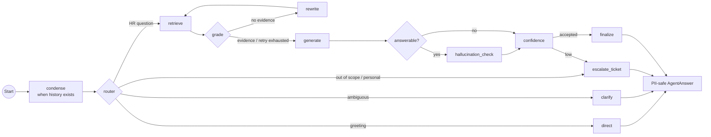

# Architecture Diagram

Code on `develop` is the source of truth. Product traffic uses REST polling; streaming transport remains future scope.

## System overview

## Responsibilities

| Component | Current responsibility |
|---|---|
| Next.js FE | Login, chat, polling, clarification, retry, citation viewer and admin screens |
| FastAPI BE | JWT/RBAC, conversations, recent history, background processing, persistence, citation access and ticket creation |
| Agent service | Stateless condense, intent routing, RAG, guardrails, generation, confidence, clarification and escalation draft |
| PostgreSQL | Users, conversations, messages, chat requests, tickets and document metadata |
| Chroma Cloud | RAG chunks and embeddings |

## Agent flow

Detailed current diagrams are in [`project/diagrams`](project/diagrams), and the Agent-BE-FE contract is in [`project/integration/AGENT_BE_FE_INTEGRATION.md`](project/integration/AGENT_BE_FE_INTEGRATION.md).
