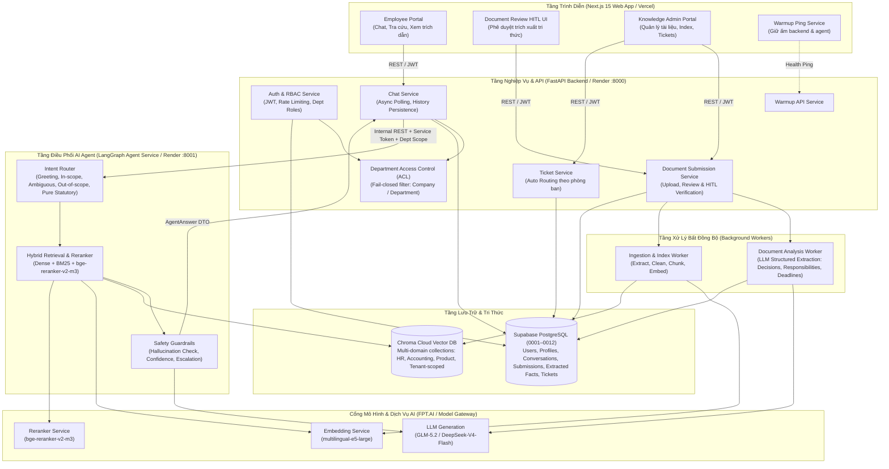
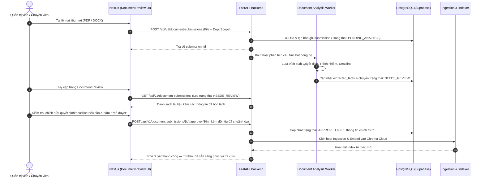

# Kiến Trúc Hệ Thống & Sơ Đồ Điều Phối (Architecture Diagram) — P-153

> **Source of Truth:** Mã nguồn trên nhánh `develop` là chuẩn mực hoạt động của hệ thống.

---

## 1. Sơ Đồ Hệ Thống Tổng Quan (System Overview)

Hệ thống được thiết kế theo kiến trúc microservices phân tách rõ ràng giữa **Client Portal (Next.js 15)**, **Backend Nghiệp Vụ & Phân Quyền (FastAPI Backend)**, **Agent Điều Phối Tri Thức (LangGraph Agent Service)**, **Worker Phân Tích & Bóc Tách Cấu Trúc (Document Analysis Worker)**, cùng hệ thống lưu trữ phân tầng (**Supabase PostgreSQL** & **Chroma Cloud**).



---

## 2. Phân Định Trách Nhiệm Từng Thành Phần (Responsibilities)

| Thành phần | Vai trò & Trách nhiệm chính |
|---|---|
| **Next.js 15 Frontend** | Giao diện đăng nhập/đăng ký chọn phòng ban, Chat tương tác đa lượt, hiển thị Trích dẫn nguồn (Citations), Giao diện duyệt tài liệu HITL ([`DocumentReview.tsx`](file:///d:/AI%20Engineer/VIN%20AI/P-153/frontend/components/DocumentReview.tsx)), Quản lý Tickets, và giữ ấm dịch vụ ([`WarmupPing.tsx`](file:///d:/AI%20Engineer/VIN%20AI/P-153/frontend/components/WarmupPing.tsx)). |
| **FastAPI Backend** | Quản lý JWT & RBAC phân quyền phòng ban, điều phối Chat bất đồng bộ (REST Polling), tiếp nhận và lưu trữ bài nộp tài liệu ([`document_submissions.py`](file:///d:/AI%20Engineer/VIN%20AI/P-153/backend/app/api/v1/endpoints/document_submissions.py)), kiểm tra quyền truy cập ([`access_control.py`](file:///d:/AI%20Engineer/VIN%20AI/P-153/backend/app/services/access_control.py)), và tự động tạo Ticket khi Agent yêu cầu escalation. |
| **LangGraph Agent** | Điều phối luồng xử lý thông minh không lưu trạng thái (Stateless): Viết lại câu hỏi đa lượt (`condense`), Phân loại ý định (`router`), Tìm kiếm lai (`retrieve`), Đánh giá tài liệu (`grade`), Viết lại truy vấn (`rewrite`), Sinh câu trả lời có dẫn nguồn (`generate`), Kiểm tra ảo giác (`hallucination_check`), Tính điểm tin cậy (`confidence`), và Đóng gói kết quả hoặc Yêu cầu mở Ticket (`escalate_ticket`). |
| **Document Analysis Worker** | Tự động bóc tách các trường dữ liệu có cấu trúc từ tài liệu (*Quyết định*, *Trách nhiệm*, *Thời hạn*) bằng LLM có kiểm chứng schema Pydantic, hỗ trợ quy trình HITL trước khi chính thức nạp vào kho vector. |
| **PostgreSQL (Supabase)** | Quản trị dữ liệu quan hệ với 12 migrations liên tục (`0001`–`0012`): Bảng người dùng, thông tin cá nhân & phân quyền phòng ban, lịch sử hội thoại, bài nộp tài liệu & thông tin bóc tách cấu trúc, danh mục ticket và audit logs. |
| **Chroma Cloud Vector DB** | Lưu trữ các chunk văn bản và vector nhúng 1024 chiều theo từng collection chuyên biệt (`hr_documents`, `accounting`, `product`, `tenant_nexatech_knowledge`). |

---

## 3. Sơ Đồ Luồng AI Agent (LangGraph Workflow)

```mermaid
flowchart TD
    START((Bắt đầu)) --> CONDENSE{"Có lịch sử hội thoại?"}
    CONDENSE -->|Có| CONDENSE_NODE["condense:\nViết lại câu hỏi độc lập"] --> ROUTER{"router:\nPhân loại ý định"}
    CONDENSE -->|Không| ROUTER

    ROUTER -->|greeting| DIRECT["direct:\nChào hỏi thân thiện"] --> FINALIZE_RESP
    ROUTER -->|ambiguous| CLARIFY["clarify:\nHỏi lại thông tin cần làm rõ"] --> FINALIZE_RESP
    ROUTER -->|pure_statutory| STATUTORY["statutory:\nTừ chối tư vấn luật thuần túy"] --> FINALIZE_RESP
    ROUTER -->|out_of_scope / personal| ESCALATE_TICKET["escalate_ticket:\nTạo Ticket chuyển phòng ban"] --> FINALIZE_RESP

    ROUTER -->|in_scope (HR / Kế toán / SP)| RETRIEVE["retrieve:\nHybrid Search (Chroma + BM25)\nkèm Bộ lọc Phòng ban (ACL)"]
    RETRIEVE --> RERANK["rerank:\nbge-reranker-v2-m3\nTính điểm phù hợp"]
    RERANK --> GRADE{"grade:\nKiểm tra tài liệu có đủ thông tin?"}

    GRADE -->|Không đủ & chưa hết lượt| REWRITE["rewrite:\nViết lại từ khóa tìm kiếm"] --> RETRIEVE
    GRADE -->|Đủ thông tin HOẶC hết lượt retry| GENERATE["generate:\nSinh câu trả lời kèm Citation"]

    GENERATE --> ANSWERABLE{"Có trả lời được không?"}
    ANSWERABLE -->|Có| HALLUC_CHECK["hallucination_check:\nĐối chiếu câu trả lời với nguồn"]
    ANSWERABLE -->|Không| CONFIDENCE

    HALLUC_CHECK --> CONFIDENCE["confidence:\nTính điểm tin cậy tổng hợp"]
    CONFIDENCE --> CONF_CHECK{"Điểm tin cậy đạt ngưỡng?"}

    CONF_CHECK -->|Đạt (>= 0.7)| FINALIZE["finalize:\nĐóng gói AgentAnswer kèm nguồn"] --> FINALIZE_RESP
    CONF_CHECK -->|Thấp (< 0.7)| ESCALATE_TICKET

    FINALIZE_RESP["PII-Safe AgentAnswer DTO\n(Trả về cho Backend)"] --> END_STATE((Hoàn tất))
```

---

## 4. Sơ Đồ Quy Trình Phê Duyệt Trích Xuất Tri Thức (HITL Document Review Workflow)


