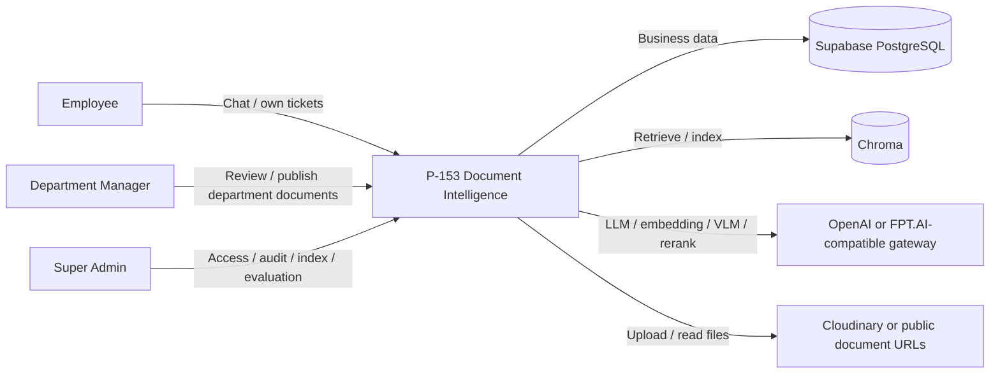
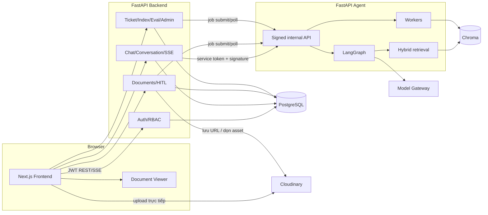
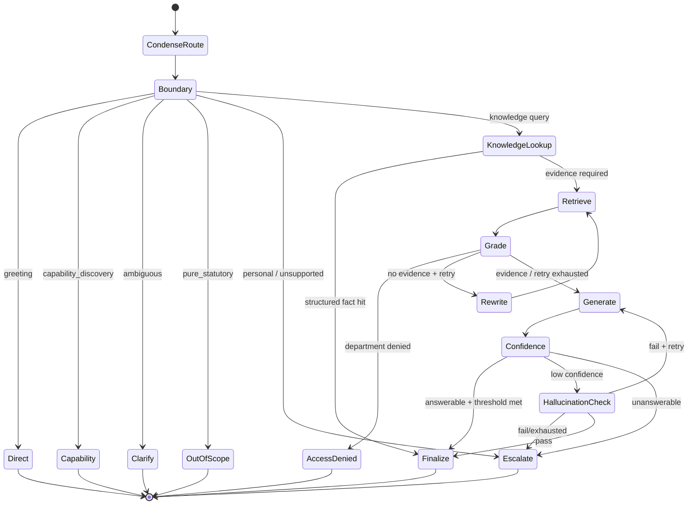
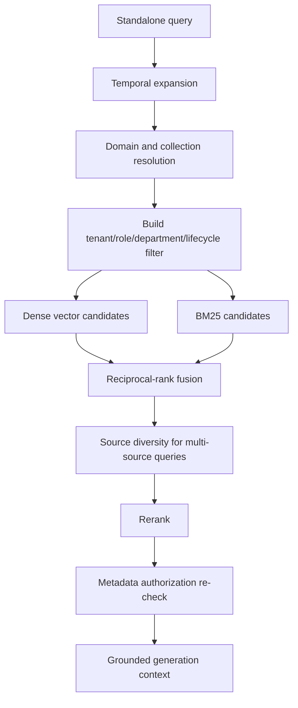
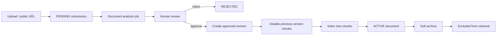
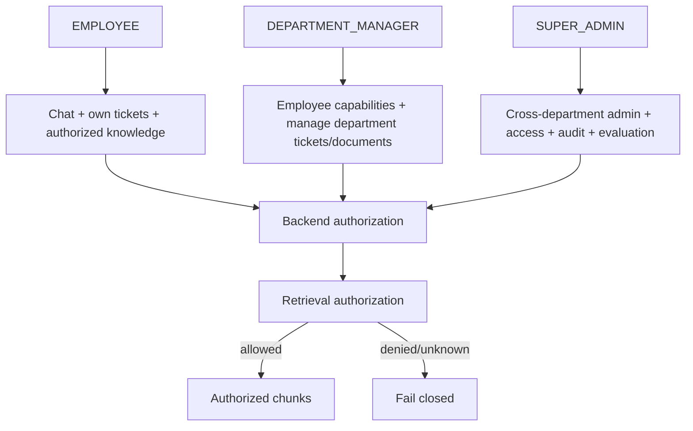

# Architecture Diagrams — P-153

Các sơ đồ dưới đây được đồng bộ với `develop@87a85aa`. Phần giải thích quyết định kiến trúc nằm tại [`ARCHITECTURE.md`](../../ARCHITECTURE.md).

## 1. System context

## 2. Container diagram

## 3. Agent workflow

## 4. Retrieval and authorization

## 5. Document lifecycle

## 6. Role boundary

