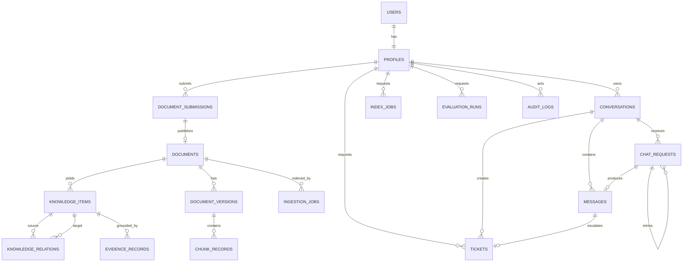

# Mô hình dữ liệu quan hệ

**Baseline:** `develop@87a85aa`
**Nguồn chuẩn vật lý:** `supabase/migrations/`

## Nhóm dữ liệu

| Nhóm | Bảng/đối tượng chính | Trách nhiệm |
|---|---|---|
| Identity | `users`, `profiles` | Tài khoản, role, department, trạng thái truy cập |
| Chat | `conversations`, `messages`, `chat_requests`, `citations` | Lịch sử, state xử lý, câu trả lời và nguồn |
| Escalation | `tickets` | Yêu cầu hỗ trợ, assignee, trạng thái và liên kết chat |
| Documents | `document_submissions`, `documents`, `document_versions`, `ingestion_jobs` | HITL, version, lifecycle và ingestion |
| Knowledge | knowledge items, relations, evidence, audit | Dữ liệu cấu trúc có nguồn và trạng thái duyệt |
| Operations | `index_jobs`, `evaluation_runs`, audit logs | Rebuild, đánh giá và truy vết thao tác |

## Invariant quan trọng

- `profiles.id` gắn với `users.id`; role chuẩn là `EMPLOYEE`, `DEPARTMENT_MANAGER`, `SUPER_ADMIN`.
- Conversation/message/citation phải kiểm tra owner và document ACL.
- Document mới chỉ có hiệu lực retrieval sau approve/publish; archive và phiên bản cũ bị loại khỏi retrieval nhưng vẫn giữ khả năng audit.
- Department Manager chỉ thao tác trong phòng ban; Super Admin mới có quyền xuyên phòng ban.
- Job và request dùng state machine; retry phải giữ lineage và tránh side effect trùng.

Tên cột, enum, index và foreign key cụ thể phải lấy từ migration tại thời điểm triển khai; sơ đồ này chỉ mô tả quan hệ logic ổn định.
