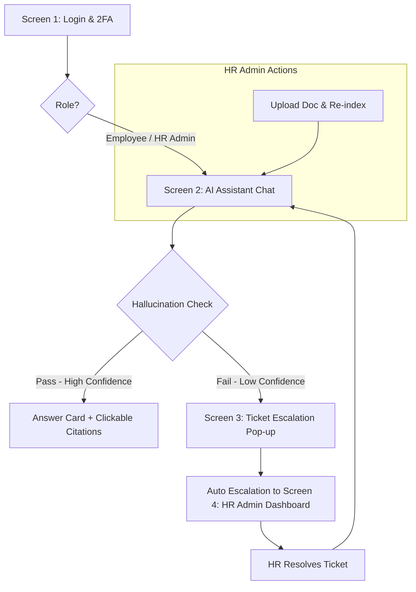

# 📋 BẢN MÔ TẢ TEST WORKFLOW — HR DOCUMENT INTELLIGENCE AGENT

## 1. TỔNG QUAN HỆ THỐNG & MỤC TIÊU KIỂM THỬ

* **Tên hệ thống:** HR Document Intelligence Agent
* **Mục tiêu kiểm thử:** Đảm bảo toàn bộ luồng nghiệp vụ hoạt động chính xác từ khâu đăng nhập bảo mật (2FA), hỏi đáp với AI (RAG & Kiểm soát ảo giác - Hallucination Check), tự động chuyển tiếp hỗ trợ (Auto Escalation) khi AI không tự tin, đến luồng quản trị tài liệu và xử lý Ticket của bộ phận HR Admin.

---

## 2. PHẠM VI & PHÂN VÙNG MÀN HÌNH (SCOPE)

1. **SCREEN 1 — Login & Auth:** Xác thực người dùng, phân quyền (Employee / HR Admin) và kiểm tra 2FA.
2. **SCREEN 2 — AI Assistant Chat:** Giao diện Chatbot AI, xử lý truy vấn, hiển thị tiến trình (Thinking Indicator), kiểm tra độ tin cậy (Confidence Score) và trích dẫn nguồn (Citations).
3. **SCREEN 3 — Ticket Escalation Pop-up:** Giao diện cảnh báo khi AI có độ tin cậy thấp và tự động khởi tạo Ticket gửi đến HR.
4. **SCREEN 4 — HR Admin Dashboard:** Giao diện dành riêng cho HR Admin để quản lý tài liệu/Vector Indexing và quản lý/xử lý danh sách Ticket.

---

## 3. CÁC LUỒNG KIỂM THỬ NGHIỆP VỤ CHÍNH (END-TO-END WORKFLOWS)

---

### 🔄 WORKFLOW 1: Luồng Hỏi Đáp AI Thành Công (Happy Path - High Confidence)
* **Mô tả:** Người dùng đăng nhập thành công, đặt câu hỏi cho AI. Hệ thống RAG truy xuất dữ liệu có độ tin cậy cao và trả về câu trả lời chuẩn xác cùng trích dẫn nguồn.
* **Các bước thực hiện:**
  1. Đăng nhập tại **Screen 1** (Chọn vai trò Employee/HR Admin -> Nhập mã 2FA hợp lệ).
  2. Tại **Screen 2**, nhập câu hỏi (Ví dụ: *"What's the hybrid work policy?"*).
  3. Hệ thống hiển thị `Thinking Indicator`, thực hiện `Intent Router & RAG Retrieval`.
  4. Hệ thống đánh giá `Confidence Score` đạt mức **High Confidence** (Pass Hallucination Check).
  5. Hiển thị `Answer Card` chứa câu trả lời và danh sách `Clickable Citations` (trích dẫn có thể click để xem nguồn).
* **Kết quả mong đợi:**
  * Câu trả lời hiển thị chính xác, khớp với tài liệu HR.
  * Các link trích dẫn (citations) click vào mở ra đúng vị trí tài liệu tham chiếu.
  * Trạng thái hoàn thành ở nút `Final Answer Shown`.

---

### 🔄 WORKFLOW 2: Luồng Tự Động Đẩy Ticket Hỗ Trợ (Escalation Path - Low Confidence)
* **Mô tả:** Người dùng đặt câu hỏi mà AI không tìm thấy tài liệu phù hợp hoặc độ tin cậy thấp. Hệ thống cảnh báo và tự động tạo Ticket chuyển cho HR Admin.
* **Các bước thực hiện:**
  1. Người dùng gửi truy vấn tại **Screen 2**.
  2. Hệ thống xử lý RAG và trả về **Low Confidence** (Fail Hallucination Check).
  3. Hệ thống tự động chuyển sang **Screen 3 (Ticket Escalation Pop-up)**.
  4. Hiển thị cảnh báo `Low Confidence Warning` (Answer flagged uncertain).
  5. Hệ thống tự động kích hoạt `HR Ticket Created` dạng Pop-up modal.
  6. Kích hoạt `Auto Escalation`, tự động đẩy thông tin Ticket tới **Screen 4 (Ticket Management Table)** của HR Admin.
* **Kết quả mong đợi:**
  * AI không đưa ra câu trả lời sai lệch (tránh ảo giác/hallucination).
  * Pop-up cảnh báo xuất hiện ngay lập tức với thông tin Ticket được tạo tự động.
  * Ticket hiển thị ngay trên bảng quản lý của HR Admin với trạng thái ban đầu (ví dụ: `New` / `Pending`).

---

### 🔄 WORKFLOW 3: Luồng HR Admin Xử Lý Ticket & Phản Hồi Người Dùng (Ticket Resolution Flow)
* **Mô tả:** HR Admin tiếp nhận Ticket từ hệ thống, xử lý và phản hồi lại cho người dùng trên màn hình Chat.
* **Các bước thực hiện:**
  1. HR Admin đăng nhập vào **Screen 4 (HR Admin Dashboard)** -> **Ticket Management Table**.
  2. Kiểm tra thông tin Ticket: Trạng thái (Status), Người xử lý (Assignee), Thời hạn xử lý (SLA).
  3. HR Admin tiến hành xử lý câu hỏi và nhấn trả lời/hoàn thành (`HR resolves & notifies user`).
* **Kết quả mong đợi:**
  * Thông báo/Kết quả phản hồi từ HR Admin được cập nhật ngược trở lại giao diện Chat của người dùng tại **Screen 2** (`Answer Card`).
  * Trạng thái Ticket trên Dashboard chuyển sang `Resolved`.

---

### 🔄 WORKFLOW 4: Luồng Cập Nhật Tài Liệu HR & Re-index (Document Management & Re-indexing Flow)
* **Mô tả:** HR Admin bổ sung/cập nhật tài liệu quy định mới và chạy Re-index để AI cập nhật tri thức RAG.
* **Các bước thực hiện:**
  1. HR Admin truy cập **Screen 4** -> **Document Management**.
  2. Tải lên tài liệu mới (Upload) và kiểm tra `Vector indexing status` (Pending -> In Progress -> Completed).
  3. Nhấn `Re-index` để cập nhật cơ sở dữ liệu Vector cho RAG.
  4. Người dùng quay lại **Screen 2** đặt lại câu hỏi từng bị cảnh báo Low Confidence trước đó.
* **Kết quả mong đợi:**
  * Tài liệu mới được chuyển đổi thành Vector thành công.
  * Hệ thống RAG truy xuất được tri thức mới -> Đạt **High Confidence** -> Trả về câu trả lời đúng thay vì tạo Ticket.

---

### 🔄 WORKFLOW 5: Luồng Bảo Mật & Phân Quyền (Auth & Security Flow)
* **Mô tả:** Kiểm tra tính an toàn của khâu xác thực 2FA và phân quyền giữa Employee và HR Admin.
* **Các bước thực hiện:**
  1. Thử đăng nhập với mã OTP/2FA sai hoặc hết hạn.
  2. Đăng nhập với quyền **Employee** và thử truy cập trực tiếp URL của **Screen 4 (HR Admin Dashboard)**.
* **Kết quả mong đợi:**
  * Mã 2FA sai/hết hạn bị từ chối và yêu cầu gửi lại mã.
  * Tài khoản **Employee** bị chặn không thể truy cập vào **Screen 4** (Redirect hoặc hiển thị lỗi 403 Forbidden).
---
